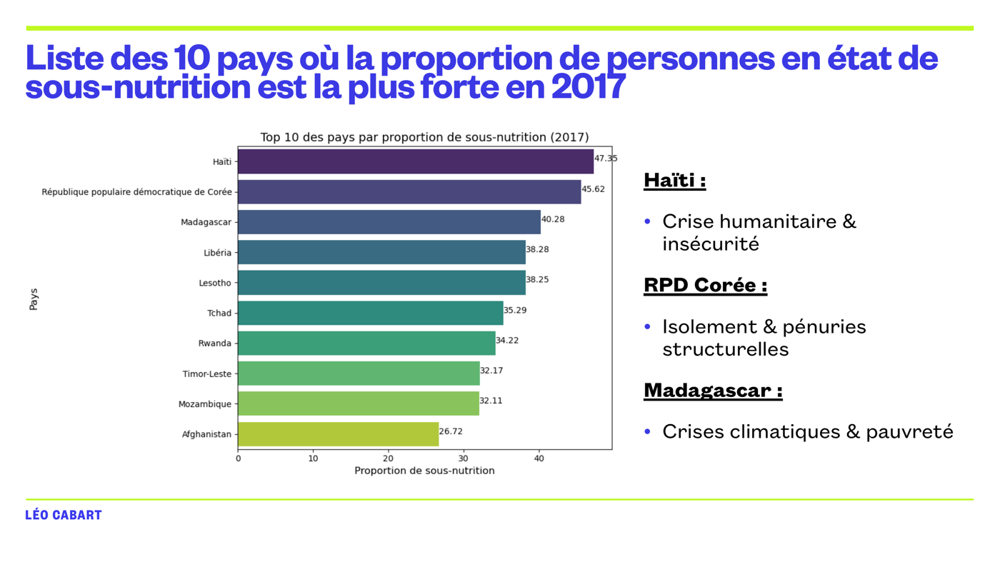

# Étude de l'alimentation dans le monde (données FAO)

> En 2017, la nourriture disponible aurait suffi à nourrir 9,9 milliards de personnes, soit 132 % de la population mondiale. Pourtant, 7,1 % de la population est sous-alimentée. L'étude localise les pays touchés, décrit l'usage des céréales et illustre le problème avec le manioc en Thaïlande.



**Projet 4 · OpenClassrooms Data Analyst · janvier 2026** · Python · pandas · matplotlib / seaborn / plotly · Jupyter

---

## Besoin métier
Pour une équipe de la FAO, il s'agit de réaliser une étude sur l'alimentation mondiale à partir de 2013 :
- mesurer l'ampleur de la sous-nutrition ;
- calculer le potentiel de la disponibilité alimentaire ;
- analyser l'usage des céréales et la répartition de l'aide alimentaire.

## Données
- **4 fichiers FAO :**
  - disponibilité alimentaire par pays et produit (kcal, tonnes, origine animale ou végétale) ;
  - personnes sous-alimentées par pays et période ;
  - population ;
  - aide alimentaire reçue (2013–2016).
- **Points d'attention :**
  - unités hétérogènes (kcal/pers/jour, milliers de tonnes, millions d'habitants) à harmoniser avant tout calcul ;
  - valeurs « <0,1 » dans la sous-nutrition, à convertir.

## Démarche
1. Explorer et nettoyer chaque fichier : types, unités, valeurs manquantes, doublons.
2. **Calcul du nombre théorique de personnes nourrissables :** disponibilité en kcal × population ÷ besoin de référence (2 100 kcal/jour).
3. Décomposer la disponibilité intérieure : nourriture, alimentation animale, pertes, semences, transformation.
4. Classer les pays : sous-nutrition, aide reçue, disponibilité par habitant.
5. Étude de cas : le manioc en Thaïlande.

## Résultats
| Constat | Chiffre |
|---|---|
| Population sous-alimentée (2017) | **7,1 %** |
| Personnes nourrissables avec toute la disponibilité | **9,9 Md**, soit 132 % de la population mondiale |
| Personnes nourrissables avec les seuls végétaux | **8,2 Md**, soit 109 % |
| Disponibilité intérieure consacrée à la nourriture humaine | 49 %, contre 13 % à l'alimentation animale et 5 % aux pertes |
| Céréales | 43 % vont à l'alimentation animale, contre 34 % à l'alimentation humaine |
| Thaïlande | 9 % de sous-nutrition, alors que 83 % du manioc produit est exporté |

**Lecture :** la sous-nutrition est un problème de **répartition** (exportations, alimentation animale, conflits, climat) plus que de production. En Thaïlande, réorienter une petite part des exportations de manioc couvrirait les besoins d'au moins 10 % de la population.

## Limites et pistes
- Le besoin de 2 100 kcal/jour est un standard moyen qui ne tient compte ni de l'âge, ni du sexe, ni de l'activité.
- La disponibilité moyenne nationale masque les inégalités au sein des pays.
- **Pistes :** relier l'aide aux crises (conflits, sécheresses) et actualiser au-delà de 2017.

## Compétences mobilisées
`Python` · `pandas` · `Nettoyage et harmonisation d'unités` · `Agrégations` · `Visualisation` · `Restitution`

## Contenu
```
Leo_Cabart_notebook_012025.ipynb       # notebook d'analyse (lit les fichiers de data/)
Leo_Cabart_3_presentation_012025.pdf   # présentation des résultats
data/                                  # 4 fichiers FAO
```

---
Leo Cabart · Data Analyst · [Portfolio](https://lcabart21.github.io) · [GitHub](https://github.com/lcabart21)
